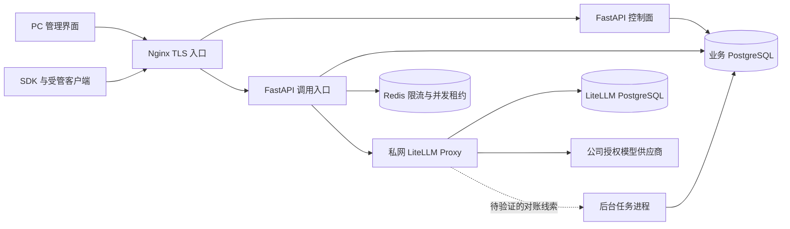

# 技术架构方案

FastAPI 模块化单体承载控制面及轻量数据面。LiteLLM Proxy 独立部署处理协议转换和供应商访问。对外只暴露 Nginx 下的管理界面和经验证的模型 API。数据面与业务后端共享应用代码，可在容量需要时使用独立 Uvicorn 实例或工作进程。将业务准入和配额预留放在同一业务事务内，可以使用当前组织授权、归属快照和账本状态，LiteLLM 版本变化主要影响模型调用边界。代价是平台承担 SSE 转发、计量和额外延迟，纳入 P0 验证。

## 技术栈和职责

| 层 | 技术 | 职责 |
| --- | --- | --- |
| PC 管理端 | Vue 3、TypeScript、Vite、Element Plus、ECharts、Pinia、Vue Router、Axios | 工作台和管理界面，客户端路由按服务端权限控制。 |
| 业务服务 | Python 3.12、FastAPI、Uvicorn、SQLAlchemy 2.x、Alembic、Pydantic 2.x、HTTPX | 账号与会话、组织和项目、密钥、模型、配额、调用入口、账务、报表、审计、风险。HTTPX 处理到 LiteLLM 的受控流式代理。 |
| 业务数据库 | PostgreSQL | 业务权限、凭据标识、调用事件、预算预留、账本和审计的权威数据。 |
| 缓存及运行时控制 | Redis | Key RPM、并发租约和低风险读缓存。 |
| 模型代理 | LiteLLM Proxy | 内网模型网关、协议适配、供应商 Key 注入、供应商响应；代理日志可辅助排查和对账。 |
| Web 认证 | JWT、Argon2id | 访问令牌和会话管理，Argon2id 存储密码摘要。 |
| 工程和部署 | uv、Docker Compose、Nginx、Pytest、Playwright | 锁定 Python 依赖、容器化部署、入口控制、接口与浏览器验证。 |

## 数据模型与状态

- 用户、部门、角色绑定、主管部门授权、项目、项目部门和项目成员关系构成权限模型。对象以稳定 ID 关联，停用与归档保留历史。
- `api_key` 保存随机 Key 的标识、带服务端密钥的摘要、生命周期、白名单和唯一业务归属。`provider`、`model_route` 与 `price_version` 管理供应商、路由和计价版本。模型与价目变动仅作用于后续调用。
- `gateway_request` 以平台生成的全局请求 ID 记录准入、归属、协议、状态和上游 ID。`usage_ledger` 将同一请求的用量与费用结算、冲正或调整逐笔记入，使用唯一结算事件键保证幂等。
- `quota_policy`、`quota_period`、`quota_reservation` 记录适用范围、原币、固定周期、已用与预留金额。并发租约与 PostgreSQL 中的预算预留分开释放和恢复。额度周期使用独立且固定的时区边界，时区调整在下一周期生效，历史周期保留原边界。
- `audit_event` 记录操作者、目标、动作、原因、脱敏变更和结果，`risk_event` 管理规则版本、告警分组、脱敏摘要和处置。`outbox/job` 保存待处理任务、重试次数和失败证据。
- 首版分别建立业务库和 LiteLLM 库及独立账号，可共用 PostgreSQL 实例。应用迁移只负责业务库。统计先用索引和 SQL 聚合，按查询压力评估日汇总。

## 调用链路与一致性

1. Nginx 按路由白名单分发，限制请求体、上游超时和 SSE 缓冲，仅信任配置内的代理与来源头。首发允许明确的 POST 路由。模型发现与计数辅助路径经独立验证后再开放。屏蔽管理端点、通用透传和客户端提供的供应商凭据。
2. FastAPI 根据 Key 摘要校验有效期、用户及组织状态、项目成员、模型和协议。读 PostgreSQL 权威状态以免撤销受缓存滞后影响。外部请求 ID 只作辅助，自有 ID 注入内部链路。向 LiteLLM 发的是私网最小权限服务凭据，开发者子 Key 不进入上游。路由别名、认证头与少量必要协议头由平台校验或重建。
3. Redis 原子执行 RPM 和并发租约获取。PG 事务以固定顺序锁定 Key 和项目周期行，在同一事务检查 `已结算 + 预留 + 新申请 ≤ 上限`，创建调用记录和预留；Redis、PG 或价目不可用时拒绝新调用并记录原因。停用、撤销和提交准入使用同一权威状态，变更提交后新准入失效，已入场请求按在途策略处理。
4. 预留按批准模型与协议的输入上界、最大输出和适用最高单价计算。工具、缓存写入倍价、服务等级与其他计价项要么有明确上界，要么在首发参数策略中禁用。客户端未给输出上限时使用公开的路由默认值，超限参数按协议返回错误。公式和输入估算必须通过实际路由验证，无法证明上界的路由仅放在受限试点。
5. 派发前持久化准备发送状态。重启后无法确认该状态的请求是否上游已收到时，按待核对处理。HTTPX 转发请求并增量处理 SSE，只保留用于计量和规则扫描的有限缓冲，保留协议事件边界与错误语义。记录最终用量及上游 ID。首发关闭自动回退及会产生二次计费的重试，同一请求在发送后失联按可能已计费处理。客户端断开时尝试终止上游，确认或补偿依据供应商支持和可得用量。
6. 同一事务结算用量、账本、预留和待处理任务。未发往上游可安全释放，已发起但凭证缺失保留预留并标待核对。恢复任务按超时状态扫描，依证据结算或有审计地释放。无法证明未计费的记录不按零费用自动结算。重复事件只能形成一次结算。
7. 发现实际上游金额超过预留时，照实入账、锁定后续准入并告警。费用调整通过追加分录完成。已入场请求可继续到终止或超时，紧急事件可尝试下线供应商路由和关闭本地连接，上游停止计费能力取决于实际取消验证。

Key 无效或缺失返回 401，已知身份缺少模型或项目权限返回 403，频率、并发和预算拦截返回 429，关键依赖不可用返回 503。错误体遵循选定模型协议，并包含平台请求 ID。SSE 已开始时用该协议支持的错误事件或明确的异常终止记录失败。

## 用量和费用

| 供应商口径 | 输入归一化 | 计价规则 |
| --- | --- | --- |
| OpenAI | Chat `prompt_tokens` 或 Responses `input_tokens` 含缓存命中时按当前协议字段拆出缓存读取。 | 未缓存输入、缓存输入和输出分别计价。推理 Token 若已包含在输出则仅作细项。 |
| DeepSeek | Chat `prompt_tokens` 采用显式 hit/miss 时校验二者合计，避免与同义缓存字段重复加总。 | 分别使用命中、未命中和输出价，其他协议按版本另行校验。 |
| Anthropic | Messages 输入总量按非缓存输入、缓存创建及缓存读取合计，保留可得的缓存写入类别。 | 非缓存输入、缓存写入、缓存读取、输出各用对应价格。 |

总 Token 为归一化输入加输出，原始安全用量字段和规则版本随账保存。每项费用以 Decimal/NUMERIC 计算，按价目单位换算，汇总后按需求显示舍入。试点按 USD 维护同币种价目和额度；价目来源、有效区间、模型版本和服务等级明确后才允许放量。财务账单与调用计价分别保留，合同折扣、税费或账单粒度差异按可得证据对账，供应商只给聚合数据时复核到凭据和时间窗口。参考 [OpenAI 价格](https://developers.openai.com/api/docs/pricing)、[DeepSeek 价格](https://api-docs.deepseek.com/quick_start/pricing/)、[Anthropic 价格](https://platform.claude.com/docs/en/about-claude/pricing) 和 [Anthropic 缓存字段](https://platform.claude.com/docs/en/build-with-claude/prompt-caching)。

## 安全、部署与运维

- 控制面使用短期 JWT 与可撤销会话。每次业务查询读取当前数据范围，用户停用、密码重置和角色变更使旧会话失效。若以 HttpOnly Cookie 持有会话凭据，启用 Secure、SameSite 和写操作 CSRF 防护。
- 开发者 Key 默认高熵随机并仅当次返回，关闭响应缓存和遥测记录。应用摘要密钥、JWT 签名密钥、LiteLLM 私网凭据、供应商密钥分别管理。供应商凭据通过部署凭据文件或运维密钥系统注入，管理界面操作引用和指纹。
- 代理层限制出网目的地，内网隔离数据库与 LiteLLM 管理端口。请求头、错误响应、Nginx 日志、LiteLLM spend logs、回调和遥测共同做泄漏测试。受控脱敏证据加密和有限留存，记录每次访问。
- 首版 Compose 组件为 Nginx、静态页面、业务 API、业务后台任务、LiteLLM、PostgreSQL 和 Redis。依赖、镜像版本和摘要固定。后台任务用租约和幂等重试处理告警及对账。采集请求量、错误率、首字节延迟、用量缺失比例、预算积压、拒绝率、组件健康和备份恢复证据。
- 入口和代理日志可通过请求 ID 关联。账务确认依赖平台观察到的协议证据，LiteLLM 内部异步日志作为待验证的补充来源。参考 [LiteLLM 请求生命周期](https://docs.litellm.ai/docs/proxy/architecture)。
