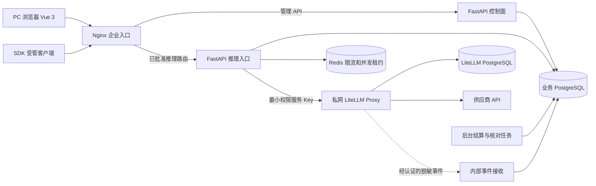

# 系统架构设计

设计基线为 [已确认需求](01-requirements.md)、[权限矩阵](02-product.md) 和 [评审架构](03-architecture.md)。首版为单企业、PC 管理后台和独立模型网关。P0 上游路由为 OpenAI Chat、DeepSeek Chat、Anthropic Messages。OpenAI Responses 在本阶段作为能力验证，正式开放随 V1.1 接入评审。

## 部署和职责边界

| 组件 | 负责 | 接口边界 |
| --- | --- | --- |
| Vue 3 管理后台 | 组织、模型、配额、调用、告警和审计界面 | 通过管理 API 读取授权数据。 |
| Nginx | 企业 TLS 入口、推理路径白名单、请求体上限、流式转发、可信转发头 | 仅路由明确的管理和推理路径。SSE 关闭响应缓冲并采用单独超时。 |
| FastAPI 控制面 | 身份、组织、项目、权限、平台子 Key、价目、配额、审计和告警 | Router → Service → Repository，Pydantic 为 HTTP 数据契约。 |
| FastAPI 推理入口 | 身份归因、模型授权、限流、预算预留、受控转发、用量采集和结算 | 与控制面共用模块化单体和业务库。按需要以独立 Uvicorn 进程隔离连接池。 |
| LiteLLM Proxy | 调用路由、协议适配、供应商认证和响应转发，提供代理级日志与回调 | 仅私网可达。使用限定模型的 LiteLLM Virtual Key 接受 FastAPI 调用，供应商凭据只在 LiteLLM 使用。 |
| PostgreSQL | 业务库保存归属和账本。LiteLLM 库保存代理自身数据 | 可共用实例，分库、连接身份和迁移。业务端不依赖 LiteLLM 内部表结构。 |
| Redis | 平台子 Key RPM 与并发租约 | 配额金额以 PostgreSQL 为准。代理如需 Redis，使用独立实例或隔离凭据与前缀。 |
| 后台任务 | 对账、风险告警、异步补偿与保留策略 | 用 PostgreSQL 租约和幂等重试。 |

部署采用 Docker Compose。Nginx、Vue 静态资源、FastAPI、任务进程、LiteLLM、PostgreSQL 和 Redis 使用明确的服务网络。入口、业务存储、代理和回调网络按 [安全设计](SECURITY.md) 隔离。

## 准入与用量结算

1. FastAPI 检查路由和载荷，解析 Key，使用受控摘要匹配并校验发行状态、所有者、部门、项目成员和模型白名单。模型以别名精确匹配授权关系，路由的模型版本、计价版本及认证范围由服务端解析。对未授权模型、空授权集及未验证协议默认拒绝。
2. 以 Redis 原子计数消费 RPM，并取得带请求 ID 的并发租约。租约使用心跳、TTL 和拥有者校验释放。Redis 不可用时拒绝新的受影响请求。已消费 RPM 保留至窗口结束。
3. PostgreSQL 同一事务锁定有效授权资源和两个预算周期行，顺序固定为 Key 授权记录、关联组织授权、按稳定全局 ID 排序的周期行。根据固定模型和快照价目核对各周期 `已结算 + 在途预留 + 本次上界 ≤ 上限`，保存调用快照与两条预留。Key 与项目都计入同一笔实际费用，每个作用域各计一次。
4. 预留金额使用未缓存输入、可计费输入上界、最大输出、可能缓存写入等允许场景的最高单价。对上下界不足以证明的参数拒绝或限制到独立试点。服务端工具、回退和自动重试在 P0 关闭。准备派发先持久化，再向 LiteLLM 发送。
5. FastAPI 增量解析协议 usage，保存上游响应标识与安全计量字段，区分成功、拒绝、取消、超时和在途未知。非流式优先使用最终响应。SSE 按协议合并累计用量或取最终快照，完整事件可重复处理。未收到终止用量时保留在途预留并按待核对处理。
6. 结算事务以请求结算事件为唯一键，锁定请求和相关周期行，记录用量与费用分录、释放预留、增记实耗和待发送事件。已知未转发才可直接释放。实际费用超过预留时照实记账、告警并阻止对应范围继续准入，等待运营复核。
7. 重启后的待派发状态若可证明未发送，可结束并释放。发送边界不明、成功回传丢失或供应商可能计费时，进入待核对。人工调整追加有来源的分录并记录审计。重试结算重用原幂等键，跨月到达仍结算原请求周期。

权限、停用和额度更新与准入事务使用相同授权资源及锁顺序。撤销提交后的新准入重新校验。已准入请求仍可能在上游执行，结束后依据可得用量落账。连接重要性见 [数据库](DATABASE.md) 和 [API 契约](API.md)。

## 回调定位

响应采集是平台结算的主要证据。LiteLLM 终态事件属于补充证据，用于识别异常、关联上游及填补经核实的缺失。一个请求可能有重复通知、异常和完成信号。平台保存事件和请求状态的独立记录，不建立基于回调到达顺序的结算假设。设计见 [API](API.md#内部回调) 和 [安全](SECURITY.md#回调认证与重放防护)。
