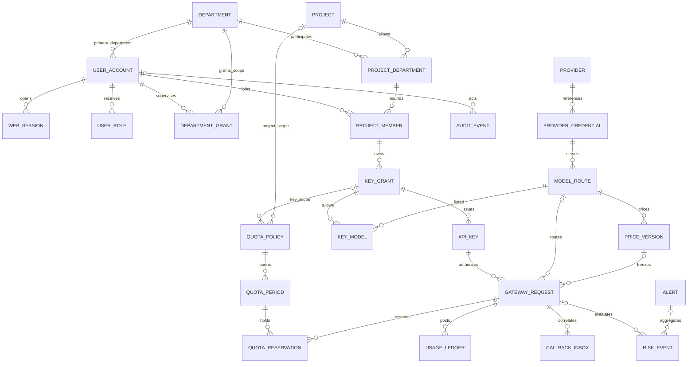

# PostgreSQL 数据库设计

业务库使用 SQLAlchemy 2.x 和 Alembic。下列为逻辑表和数据约束，本阶段未执行业务迁移。LiteLLM 使用与业务库分离的数据库及账号，独立管理代理迁移。

## ER 图

## 核心字段

| 表 | 字段与主约束 |
| --- | --- |
| `department` | `id, code, name, state, created_at, updated_at`。企业内 `code` 唯一。 |
| `user_account` | `id, login_normalized, display_name, password_hash, primary_department_id, state, auth_epoch, created_at`。登录名唯一；停用和角色变化使旧会话失效。 |
| `web_session` | `id, user_id, refresh_token_digest, auth_epoch, expires_at, revoked_at, created_at`。仅保存刷新凭据摘要。 |
| `user_role`、`department_grant` | `user_id, role_code, grant_state` 和 `supervisor_user_id, department_id, state, granted_by, granted_at`。分别按用户及角色、主管及部门唯一。角色为普通用户、部门主管和超级管理员。 |
| `project`、`project_department` | 项目 `id, code, name, state, created_at, archived_at`。参与关系 `project_id, department_id, state` 组合唯一。 |
| `project_member` | `id, project_id, department_id, user_id, state, joined_at, revoked_at`。复合外键给参与部门关系；同一项目、部门和用户唯一。 |
| `key_grant` | `id, project_member_id, owner_id, department_id, project_id, state, claim_deadline, label, rpm_limit, concurrency_limit, created_by, created_at`。归属字段须与唯一的成员关系一致，由复合外键或同一写事务校验。签发后不迁移。用稳定授权 ID 跨同一次轮换继承用量与限额。 |
| `api_key`、`key_model` | Key `id, grant_id, lookup_id, digest, digest_key_id, masked_hint, issued_at, active_from, expires_at, revoked_at, state, replaces_key_id`。查找 ID 和摘要唯一。白名单 `grant_id, model_route_id` 组合唯一，空集拒绝调用。 |
| `provider`、`provider_credential` | 供应商 `id, code, state`。凭据引用 `id, provider_id, secret_ref, fingerprint, state, rotated_at`。密钥值由获批的密钥系统或部署凭据文件管理。 |
| `model_route` | `id, credential_id, alias, upstream_model, protocol, pricing_profile, state, max_input_tokens, max_output_tokens, tool_policy, route_revision`。一个首版别名仅绑定一个已验证路由；别名唯一。 |
| `price_version` | `id, model_route_id, currency, effective_from, effective_to, unit_tokens, input_price, cache_read_price, cache_write_price, output_price, policy_version, source_ref`。同路由与币种的生效区间不重叠；按需使用结构化计价项保存分档缓存写入。 |
| `quota_policy`、`quota_period` | 策略 `id, project_id, grant_id, currency, monthly_limit, state, policy_version`，项目与授权作用域恰选一。周期 `id, policy_id, starts_at, ends_at, timezone, limit_amount, reserved_amount, settled_amount`，同一策略起始时间唯一。 |
| `quota_reservation` | `request_id, period_id, amount, state, created_at, resolved_at`，联合主键。单请求通常同时关联 Key 周期与项目周期。 |
| `gateway_request` | `id, api_key_id, grant_id, user_id, department_id, project_id, provider_id, model_route_id, price_version_id, protocol, upstream_request_id, proxy_call_id, started_at, ended_at, first_byte_ms, http_status, request_state, billing_state, reason_code, stream, risk_state`。保存关键展示名快照；未知 Key 的拒绝进入独立安全审计。可识别 Key 但未解析模型的拒绝允许路由及价格为空。 |
| `usage_ledger` | `id, request_id, entry_kind, event_key, source, normalization_version, input_tokens, output_tokens, cache_read_tokens, cache_write_tokens, reasoning_tokens, total_tokens, price_version_id, currency, amount, safe_usage, evidence_ref, recorded_at`。独立 `event_key` 唯一。确认、冲正和调整追加记录，报表按原请求时间归属。 |
| `callback_inbox` | `id, source, event_id, external_request_id, request_id, schema_version, payload_hash, safe_payload, state, attempts, next_attempt_at, received_at, processed_at`。来源和事件 ID 组合唯一。未匹配事件允许 `request_id` 暂为空；ER 中关联为最终状态。 |
| `audit_event` | `id, actor_type, actor_user_id, action, target_type, target_id, request_id, before_safe, after_safe, result, reason, occurred_at`。追加写入，服务账号、系统和无身份事件可为空用户。 |
| `risk_event`、`alert` | 风险事件 `id, request_id, rule_code, rule_version, scope_id, severity, safe_evidence_ref, detected_at, alert_id`。告警 `id, dedupe_key, scope_type, scope_id, department_id, state, count, first_seen_at, last_seen_at, assignee_id, disposition`。跨部门项目告警按归属范围生成可见摘要，公司级告警仅全局管理员可见。 |
| `outbox_job`、`system_setting` | 任务 `id, event_key, kind, ref_id, state, attempts, available_at, leased_until, last_error_code`。设置 `name, typed_value, revision, updated_by, updated_at`。全局网关开关和规则版本由后台受控更新。 |

## 一致性和查询

- 标识用 UUID，关联键建立外键或明确定义的快照约束。时间使用 `timestamptz` 和 UTC。Token 为非负 `BIGINT`，缺失值为空。价目、额度和账本采用 `NUMERIC(30,12)` 与 Python `Decimal`。输入、缓存与输出明细保持同协议归一化规则。
- OpenAI 输入总量通常已含缓存命中，DeepSeek Chat 使用明确的命中及未命中字段核对，Anthropic 输入总量含非缓存输入、缓存写入和读取。未知字段单独标记。不同币种不直接加总，价格版本不可回溯改写已结算记录。预留在持久精度上向上取整，实耗按已确认账务舍入规则保存。
- 索引优先覆盖 `gateway_request(user_id, started_at, id)`、`(department_id, started_at, id)`、`(project_id, department_id, started_at, id)`、Key、账务状态及关联 ID。任务和待核对队列按状态与可处理时间索引。主体归属读取应用角色和快照过滤。
- 项目归档、用户停用和部门停用保留历史；密钥摘要由保留策略清理。控制面审计、账务证据和风险摘要按不同期限处理。清理任务保留必要的账务或审计关联。
- 创建或更新配额策略时保证唯一生效范围。已预留与已结算金额在同一事务内增减。重复终态、补偿或回调命中唯一事件键，不重复记入费用。业务迁移和回滚策略在进入实现阶段后验证。
